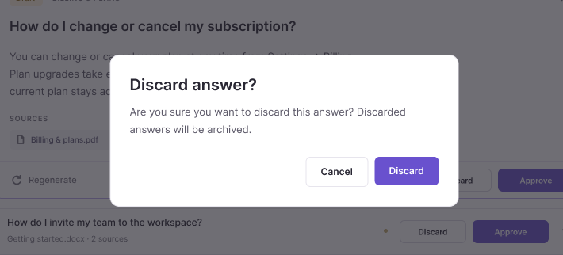
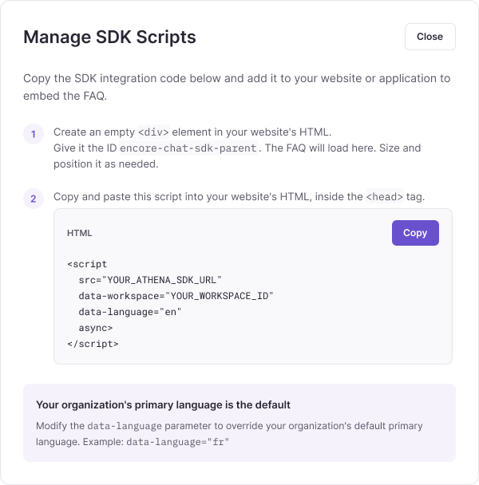
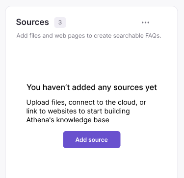

---

title: "Writing microcopy for an SaaS product"
description: "Samples of product copy written to help users move through tasks."
thumbnail: /assets/images/ux/microcopy/Workspace%20with%20dialogue.png
piece_type: "UX microcopy"

layout: single
robots: noindex, nofollow
# classes: wide

toc: false
toc_label: Contents

sidebar: false

author_profile: false

#classes: portfolio-body

---

<h1>About this piece</h1>
Athena uses AI to transform websites, documents, and other sources into searchable FAQ content. My role was to write the product's microcopy, including button labels, tooltips, empty states, confirmation dialogues, and instructional text. Working closely with Product, I focused on helping users understand complex concepts, recover from errors, and move confidently through key tasks.

# Sample 1: Confirmation dialogue

When Athena generates answers, users must review each draft and decide whether to keep it. A confirmation dialogue warns users before they discard a draft, but it can also teach users how content moves through the system.

| Before   | After   |
|----------|---------|
| **Are you sure you want to deny this answer?** | **Discard answer?** |
| Once denied, this answer will be archived and removed from the New list. | Are you sure you want to discard this answer? Discarded answers will be archived. |
| > Confirm | > Discard |
| > Cancel | > Cancel |

The original dialog used generic confirmation language that did little to reinforce the user's action. I changed the primary button label to "Discard" to make the consequence explicit. I also used the supporting text to explain that discarded answers are archived rather than permanently deleted, helping users understand where discarded content goes and reducing anxiety around the action.

**UX Writing Principle: Confirmation dialogs should clarify consequences and reduce uncertainty.**

# Sample 2: SDK integration

To host the FAQ page on their website, users integrate Athena using the provided SDK script. Because this requires some technical knowledge, Product wanted to include an in-app guide to avoid any hang-ups. 

| Before   | After   |
|----------|---------|
| **SDK Scripts** | **Manage SDK Scripts** |
| Copy the SDK script below and add it to your website or application to embed your AI helper. | Copy the SDK integration code below and add it to your website or application to embed the FAQ. |
| Copy this script and paste it in your website's html in the <head /> tag. | How to integrate |
| Step 1. In your website's html, create a 
 element that has the id encore-chat-sdk-parent and your desired sizing and position in relation to everything else on the page. The 
 element should be empty. | 1.	Create an empty <code>&lt;div&gt;</code> element in your website's HTML code. Give it the ID <code>encore-chat-sdk-parent</code>. The Assistant will load here. Size and position it as needed. |
| Step 2. Copy this script and paste it in your website's html in the <head /> tag. It will load the chat into your 
 element from step 1. | 2. Copy and paste this script into your website's HTML code, inside the <code>&lt;head&gt;</code> tag. |

The challenge was helping users complete a technical implementation task without overwhelming them. I reorganized the content into a clear sequence of steps, removed duplicated information, and used concise instructional language throughout. By breaking the process into smaller pieces and introducing descriptive headings, users can more easily scan the page and identify the information relevant to their current step.

**UX Writing Principle: Complex tasks should be broken into small, scannable steps.**

# Sample 3: Empty state

If users have not added any sources, which Athena needs to start building an FAQ, the Sources page will be empty. Product needed a message to put here.

| Before   | After   |
|----------|---------|
| **No Sources** | **You haven't added any sources yet.** |
| Add sources like documents, links, or apps that your AI agent will use to understand tasks and answer users. | Upload files, connect to the cloud, or link to websites to start building Athena's knowledge base |
| > Add Source | > Add source |

The original message explained what sources were but did not clearly guide users toward the next step. I rewrote the content to establish a clearer path forward, describing both the actions available to users and the role sources play in building Athena's knowledge base. This helps first-time users understand not only what to do next, but why it is necessary.

**UX Writing Principle: Empty states should orient users and provide a path forward.**

# Sample 4: Guidance and recovery

Users can upload real customer questions and Athena will generate FAQ answers from the sources. But if Athena can't find the relevant data, users need to know what action to take.

| Before   | After   |
|----------|---------|
| There are 25 questions without answers, update your sources or manually create answers | 25 questions couldn't be answered with existing sources. Add sources with the required information, or create a new answer to the question. |
| Go to sources | Update sources |

I rewrote the banner to explain the cause of the problem in user-facing language and provide clear next steps for resolving it. I also updated the Call-to-Action from a neutral navigation description to a description of the user's new goal.

**UX Writing Principle: Explain outcomes rather than internal system architecture.**